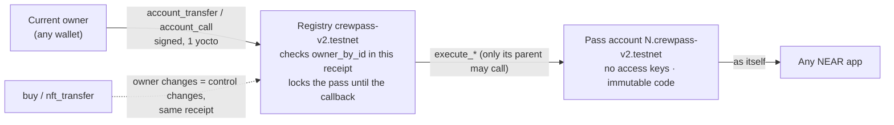

# CrewPass

**Membership NFTs that own a NEAR testnet account.** Every CrewPass is a NEP-171 NFT with its own keyless
NEAR account (`7.crewpass-v2.testnet` for pass #7). The pass earns from its programme (ticket revenue,
creator-funded rewards, referrals) as testnet NEAR in that account. It carries verifiable achievements and moves from
Bronze to Platinum, with its NFT metadata updated on chain. When it is sold, the buyer controls the account
from the same receipt, and the seller keeps no key, session or other route back in.

| | |
|---|---|
| **Track** | NEAR Hackathon Track 10: *NFTs That Do Something* (`nfts`) |
| **Network** | NEAR testnet only |
| **Live site** | https://crewpass-steel.vercel.app |
| **Public repository** | https://github.com/Tolex081/crewpass |
| **V2 registry** | [`crewpass-v2.testnet`](https://testnet.nearblocks.io/address/crewpass-v2.testnet) |
| **Pass-account code** | global contract, by hash `CuX7PYtWMa9ZG18jkHGTYKutgQVQoKNWiQSFvmmzEzRL` (immutable) |
| **V1 (archive, unchanged)** | [`crewpass.testnet`](https://testnet.nearblocks.io/address/crewpass.testnet) |
| **Tests** | 64 V2 registry + 9 pass-account unit · 11 V2 sandbox · 46 web server · V1: 36 unit + 6 sandbox |
| **Live evidence** | [deploy/v2-live-run.md](deploy/v2-live-run.md): 29 testnet transactions, 0 unexpected · [deploy/v2-web-check.md](deploy/v2-web-check.md): 12 real sign-in and access checks, 0 unexpected |
| **License** | MIT. Not audited. |

## Read in this order

1. **[docs/PROBLEM_AND_SOLUTION.md](docs/PROBLEM_AND_SOLUTION.md)**: the problem, the solution, step by step.
2. **[docs/ADR-001-pass-accounts.md](docs/ADR-001-pass-accounts.md)**: how a pass owns an account, what we
   evaluated (House of Stake TLAs, NEP-641, access keys, global contracts), what we rejected and why, with diagrams.
3. **[THREAT_MODEL.md](THREAT_MODEL.md)**: every attack, how it is blocked and the test that proves it (V1 T1–T20, companion C1–C10, V2 A1–A10, F1–F8, P1–P3…).
4. **[deploy/v2-live-run.md](deploy/v2-live-run.md)**: the whole journey on testnet, every transaction linked.
5. **[docs/PRODUCT.md](docs/PRODUCT.md)**: product, architecture, what is built and what is planned.
6. **[docs/AUDIT.md](docs/AUDIT.md)**: this build checked against the V2 brief and Track 10, line by line.

## NEAR HACKATHON submission and provenance

CrewPass addresses the gap between a membership NFT and the benefits it represents: usually the access,
earnings and authority stay with a person or a website account. Here the NEP-171 pass is paired with a
NEAR testnet account. The registry checks the current NFT owner before acting for that account. A sale
changes the NFT owner and account controller together, so the buyer receives the membership's account,
rewards and access rights.

**NEAR's role:** the account is a real account on NEAR testnet, created by the registry for the pass and
running shared immutable code without access keys. Referral and reward payments are on-chain NEAR
transfers; contract state determines tiers and access. Testnet tokens have no monetary value.

**Work window:** this repository's first commit is dated 2026-11-06, after the event opened on
2026-11-01. The repository contains no pre-hackathon product baseline. V1 was the first in-window
implementation; V2 is the in-window redesign where every pass owns an account. The
[hackathon-submission branch](https://github.com/Tolex081/crewpass/tree/hackathon-submission) is the
judge copy. [Compare the event work from the Day 1 root commit](https://github.com/Tolex081/crewpass/compare/78fc1d25b5f5ac2c79df4873857e89262f2138da...hackathon-submission);
that root commit is itself within the event and is included in the submission branch.

**Related independent project:** [Atesta](https://github.com/Tolex081/atesta) is a separate NEAR
Hackathon project by the same builder, with its own [live demo](https://atesta-near.vercel.app/).
Atesta issues non-transferable contribution credentials after organisation review; CrewPass makes
transferable membership passes that control keyless accounts. The projects solve different problems.
Atesta's README already links back to CrewPass and discloses the two independent submissions.

**Tools and libraries:** Rust and `near-sdk` 5.30.1 for contracts; React 19, TypeScript, Vite, Hono
and Node.js for the site and API; NEAR Connect and `near-api-js` for wallet and chain access; the
official NEAR AI inference SDK is an optional server-side provider. The project was developed with
OpenAI Codex assistance. See `web/package.json` and each Rust crate manifest for pinned dependencies.

## Judge walkthrough (about three minutes; no wallet needed)

The read-only path below uses existing public testnet data. No transaction is required.

1. **Open the [live CrewPass app](https://crewpass-steel.vercel.app/).** See the testnet badge and live
   registry totals. The page identifies CrewPass as membership passes that own accounts.
2. **Choose [`Discover`](https://crewpass-steel.vercel.app/#/discover) → `Study Crew`.** See the live programme, mint price, ticket share, referral
   rate, resale royalty, and the two existing passes. The ticket is 0.05 testnet NEAR and allocates
   half to the members' pool.
3. **Open [pass `#1`](https://crewpass-steel.vercel.app/#/pass/1).** See its current owner (`crewpass-carol.testnet`), Gold tier, points, activity,
   and its own account (`1.crewpass-v2.testnet`). In “The pass's own account,” check `Access keys: 0`,
   the published code hash, and “✓ No keys.” Click the account link to inspect it on NEAR Explorer.
4. **Open [`Proof`](https://crewpass-steel.vercel.app/#/proof).** Find the live transaction table and open a transaction hash. The explorer shows
   the on-chain receipt; successful and refused attempts document minting, account control, sale,
   and the hostile receiver check. For the full annotated sequence, read
   [the testnet live run](deploy/v2-live-run.md).
5. **Open [`Events`](https://crewpass-steel.vercel.app/#/events).** See the existing “Live study session,” its 0.05 NEAR testnet ticket, 30 points,
   and current seat count. Do not buy a ticket just to inspect the demo; buying is a wallet transaction.
6. **Open [`Rewards`](https://crewpass-steel.vercel.app/#/rewards/1).** See the public distribution and pass-level claim record. The programme does
   not currently have a live reward campaign, so the campaign list is empty. No wallet is needed to
   inspect the records.

**Other paths:** `Members` asks the current pass holder to connect a wallet and sign a NEP-413
message; every gated request rechecks ownership. `Creator` changes are limited to the programme's
creator and require that creator's wallet. Judges should not sign or submit transactions from a
personal wallet to try a write flow.

## What is live in the demo, and what is not

| Feature | Status for judges |
|---|---|
| Keyless account per pass, ownership handover, tier and revenue history | Live on testnet; inspect pass #1 and the Proof page |
| Fixed 5% creator resale royalty | Deployed and covered by contract tests; CrewPass's own sale method pays it |
| Creator-edited member content | Editor and on-chain contract method are deployed. Programme 1 has no saved on-chain content (`programme_content(1)` returns `null`); its visible demo description and benefit copy come from the site's sample catalogue. Saving content requires the creator wallet. |
| Reward campaigns | Contract and dashboard are deployed and tested, but programme 1 has no campaign yet. Creating one requires the creator wallet and testnet NEAR. |
| Private AI / TEE provider | Provider-agnostic interface and verified NEAR AI integration are implemented. Live TEE credentials/runtime are not configured or verified, so the hosted companion must not be described as confidential AI. |

**Submission item still needed:** no public X demo-post URL is recorded in this repository. The builder
must publish the demo video with `@NEARProtocol` and `#NEARHackathon`, then add the post link here
and use it in the form. The public repo and hosted app are available above. The submission's team
lead, email, team size, mainnet prize wallet and consent are supplied by the human in the form; they
do not belong in this repository.

## How it works in one picture



- **No key to keep.** The pass account has no access keys. Its code (published once as a global contract,
  attached by hash) obeys only its parent, the registry.
- **Control is ownership.** The registry obeys only the pass's current owner, read in the receipt that
  accepts the request. Selling the NFT changes control in that same receipt. No rotation step exists, so none can fail.
- **Async safety.** While an account operation, a listing or an `nft_transfer_call` is in flight, the pass is
  locked: it cannot be sold, moved or used twice. The lock clears in the callback on success or failure.
- **Real money.** Referral commissions and claimed rewards are NEAR transfers into the pass account,
  visible in any explorer.

## Try it

**In the browser.** Follow the wallet-free [judge walkthrough](#judge-walkthrough-about-three-minutes-no-wallet). To exercise writes,
connect your own testnet wallet, use the faucet if needed, and approve only the transaction you intend to try.

**Without installing anything.** Read [deploy/v2-live-run.md](deploy/v2-live-run.md). Each row is a real
transaction: a programme launches, Alice's pass gets its own account, referral and ticket revenue land in
it, the pass reaches Gold, Carol buys it, and Alice's five attempts afterwards are refused, including calling the
account directly. Carol then uses the account, and a hostile receiver fails.

**Read the chain yourself** ([near-cli-rs](https://github.com/near/near-cli-rs), no account needed):

```bash
near contract call-function as-read-only crewpass-v2.testnet pass_info json-args '{"token_id":"1"}' network-config testnet now
near account list-keys 1.crewpass-v2.testnet network-config testnet now
near account view-account-summary 1.crewpass-v2.testnet network-config testnet now
near contract call-function as-read-only crewpass-v2.testnet accounting json-args '{}' network-config testnet now
```

## Run the tests (Linux or WSL2)

```bash
scripts/test-v2.sh          # V2 unit tests, wasm build, sandbox tests
scripts/test-v2.sh unit     # V2 unit tests only
scripts/test.sh             # V1: 36 unit + 6 sandbox tests
cd web && npm install && npm test   # web server tests (46 pass)
```

The V2 sandbox tests publish the pass-account code as a real global contract on a local nearcore 2.14
node and prove, among others:
- a minted pass's account has no keys and runs exactly that code;
- the old owner cannot reach the account after a sale, by any route;
- a sale is refused while a 30-receipt account operation is still running;
- a failed account creation refunds the minter;
- a hostile `nft_transfer_call` receiver cannot use the account.

## Layout

```
contract-v2/    V2 registry (Rust, near-sdk 5.30.1): passes, accounts, programmes, events, rewards, tiers
pass-account/   V2 pass-account code (43.6 KB, published as a global contract by hash)
test-target/    test-only contract: slow call chain, failing call, hostile nft_transfer_call receiver
contract/       V1 contract (live at crewpass.testnet, unchanged)
test-receiver/  V1 test-only attacker contract
web/            site and API (React + Hono on Vercel): V2 pages, members area, companion, creator dashboard
deploy/         deploy scripts, testnet account lists, live runs (V1 and V2)
docs/           problem and solution, ADR, product, audit
scripts/        test runners, balances helper, House of Stake verification (incomplete)
```

## Testnet accounts

| Account | Role |
|---|---|
| `crewpass-v2.testnet` | V2 registry; also published the pass-account global contract |
| `1.crewpass-v2.testnet`, `2.crewpass-v2.testnet` | Accounts of passes #1 and #2 (created by the registry, no keys) |
| `crewpass-v2-target.testnet` | Test-only target and hostile receiver used in the live run |
| `crewpass-creator.testnet` | Creator of programme 1 ("Study Crew", demo content) |
| `crewpass-alice / bob / carol.testnet` | Demo members; `crewpass-accomplice.testnet` plays a visitor |
| `crewpass.testnet`, `crewpass-evil.testnet` | V1 contract and V1 attacker (unchanged) |

All created through the free testnet faucet. No keys are in this repository. Build hashes are in
[deploy/testnet-v2.json](deploy/testnet-v2.json).

## Honest limits

- **The registry is the trust root.** Its full-access key is intentionally retained on testnet until an
  independent security review. Anyone holding it could redeploy the registry and control every pass account.
  Remove it after review and before any production use (THREAT_MODEL U1).
- **House of Stake TLAs are not used.** They exist only on mainnet. CrewPass follows the same pattern
  (keyless account + shared global code + registry as authority) in its own contracts. See the ADR.
- Builds are `cargo near build non-reproducible-wasm`; the sha256 of each deployed wasm is recorded.
- To verify the V2 pass account, registry, and test target in the pinned Docker image, run
  `bash deploy/v2-reproducible-build.sh` from a clean, committed checkout. Docker and `cargo-near` are required.
- `bash deploy/v2-upgrade-testnet.sh` upgrades the existing testnet registry without reinitializing its state;
  run it only after the unit and sandbox checks pass and you have reviewed the resulting wasm hash.
- Sybil referrals (one person, two accounts) are not prevented. Check-ins and achievements are attested by the creator.
- The AI companion on Gemini's free tier is not private; members are told before their first message.
