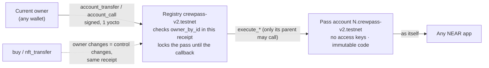

# CrewPass

**Membership NFTs that own a real NEAR account.** Every CrewPass is a NEP-171 NFT with its own keyless
NEAR account (`7.crewpass-v2.testnet` for pass #7). The pass earns from its programme (ticket revenue,
creator-funded rewards, referrals) as real NEAR in that account. It carries verifiable achievements and moves from
Bronze to Platinum, with its NFT metadata updated on chain. When it is sold, the buyer controls the account
from the same receipt, and the seller keeps no key, session or other route back in.

| | |
|---|---|
| **Track** | NEAR Hackathon Track 10: *NFTs That Do Something* (`nfts`) |
| **Network** | NEAR testnet only |
| **Live site** | https://crewpass-steel.vercel.app |
| **V2 registry** | [`crewpass-v2.testnet`](https://testnet.nearblocks.io/address/crewpass-v2.testnet) |
| **Pass-account code** | global contract, by hash `CuX7PYtWMa9ZG18jkHGTYKutgQVQoKNWiQSFvmmzEzRL` (immutable) |
| **V1 (archive, unchanged)** | [`crewpass.testnet`](https://testnet.nearblocks.io/address/crewpass.testnet) |
| **Tests** | 68 V2 contract unit · 11 V2 sandbox · 43 web server · V1: 36 unit + 6 sandbox |
| **Live evidence** | [deploy/v2-live-run.md](deploy/v2-live-run.md): 29 testnet transactions, 0 unexpected · [deploy/v2-web-check.md](deploy/v2-web-check.md): 12 real sign-in and access checks, 0 unexpected |
| **License** | MIT. Not audited. |

## Read in this order

1. **[docs/PROBLEM_AND_SOLUTION.md](docs/PROBLEM_AND_SOLUTION.md)**: the problem, the solution, step by step.
2. **[docs/ADR-001-pass-accounts.md](docs/ADR-001-pass-accounts.md)**: how a pass owns an account, what we
   evaluated (House of Stake TLAs, NEP-641, access keys, global contracts), what we rejected and why, with diagrams.
3. **[THREAT_MODEL.md](THREAT_MODEL.md)**: every attack, how it is blocked and the test that proves it (V1 T1–T20, companion C1–C10, V2 A1–A10, F1–F8, P1–P3…).
4. **[deploy/v2-live-run.md](deploy/v2-live-run.md)**: the whole journey on testnet, every transaction linked.
5. **[docs/PRODUCT.md](docs/PRODUCT.md)**: product, architecture, what is built and what is planned.
6. **[docs/AUDIT.md](docs/AUDIT.md)**: this build checked against the V2 brief and Track 10, line by line.

## How it works in one picture



- **No key to keep.** The pass account has no access keys. Its code (published once as a global contract,
  attached by hash) obeys only its parent, the registry.
- **Control is ownership.** The registry obeys only the pass's current owner, read in the receipt that
  accepts the request. Selling the NFT changes control in that same receipt. No rotation step exists, so none can fail.
- **Async safety.** While an account operation, a listing or an `nft_transfer_call` is in flight, the pass is
  locked: it cannot be sold, moved or used twice. The lock clears in the callback on success or failure.
- **Real money.** Referral commissions and claimed rewards are NEAR transfers into the pass account,
  visible in any explorer.

## Try it

**In the browser.** Open the live site, connect a testnet wallet, open *Discover → Study Crew* and mint. The pass
page shows the new account with "✓ No keys" and "✓ Runs the published pass-account code", read live from the
chain. Buy a ticket on *Events*, claim on *Rewards*, open *Members* to see tier-gated content and the companion.

**Without installing anything.** Read [deploy/v2-live-run.md](deploy/v2-live-run.md). Each row is a real
transaction: a programme launches, Alice's pass gets its own account, referral and ticket revenue land in
it, the pass reaches Gold, Carol buys it, and Alice's five attempts afterwards are refused, including calling the
account directly. Carol then uses the account, and a hostile receiver fails.

**Read the chain yourself** ([near-cli-rs](https://github.com/near/near-cli-rs), no account needed):

```bash
near contract call-function as-read-only crewpass-v2.testnet pass_info json-args '{"token_id":"1"}' network-config testnet now
near account list-keys 1.crewpass-v2.testnet network-config testnet now
near account view-account-summary 1.crewpass-v2.testnet network-config testnet now
near contract call-function as-read-only crewpass-v2.testnet accounting json-args '{}' network-config testnet now
```

## Run the tests (Linux or WSL2)

```bash
scripts/test-v2.sh          # V2: 68 unit tests, build wasm, 11 sandbox tests on a local NEAR node (~3 min)
scripts/test-v2.sh unit     # V2 unit tests only
scripts/test.sh             # V1: 36 unit + 6 sandbox tests
cd web && npm install && npm test   # 43 web server tests
```

The V2 sandbox tests publish the pass-account code as a real global contract on a local nearcore 2.14
node and prove, among others:
- a minted pass's account has no keys and runs exactly that code;
- the old owner cannot reach the account after a sale, by any route;
- a sale is refused while a 30-receipt account operation is still running;
- a failed account creation refunds the minter;
- a hostile `nft_transfer_call` receiver cannot use the account.

## Layout

```
contract-v2/    V2 registry (Rust, near-sdk 5.30.1): passes, accounts, programmes, events, rewards, tiers
pass-account/   V2 pass-account code (43.6 KB, published as a global contract by hash)
test-target/    test-only contract: slow call chain, failing call, hostile nft_transfer_call receiver
contract/       V1 contract (live at crewpass.testnet, unchanged)
test-receiver/  V1 test-only attacker contract
web/            site and API (React + Hono on Vercel): V2 pages, members area, companion, creator dashboard
deploy/         deploy scripts, testnet account lists, live runs (V1 and V2)
docs/           problem and solution, ADR, product, audit
scripts/        test runners, balances helper, House of Stake verification (incomplete)
```

## Testnet accounts

| Account | Role |
|---|---|
| `crewpass-v2.testnet` | V2 registry; also published the pass-account global contract |
| `1.crewpass-v2.testnet`, `2.crewpass-v2.testnet` | Accounts of passes #1 and #2 (created by the registry, no keys) |
| `crewpass-v2-target.testnet` | Test-only target and hostile receiver used in the live run |
| `crewpass-creator.testnet` | Creator of programme 1 ("Study Crew", demo content) |
| `crewpass-alice / bob / carol.testnet` | Demo members; `crewpass-accomplice.testnet` plays a visitor |
| `crewpass.testnet`, `crewpass-evil.testnet` | V1 contract and V1 attacker (unchanged) |

All created through the free testnet faucet. No keys are in this repository. Build hashes are in
[deploy/testnet-v2.json](deploy/testnet-v2.json).

## Honest limits

- **The registry is the trust root.** Its full-access key still exists during the hackathon (for fixes). Anyone
  holding it could redeploy the registry and control every pass account. Removing the key is the step
  before any real use (THREAT_MODEL U1).
- **House of Stake TLAs are not used.** They exist only on mainnet. CrewPass follows the same pattern
  (keyless account + shared global code + registry as authority) in its own contracts. See the ADR.
- Builds are `cargo near build non-reproducible-wasm`; the sha256 of each deployed wasm is recorded.
- Sybil referrals (one person, two accounts) are not prevented. Check-ins and achievements are attested by the creator.
- The AI companion on Gemini's free tier is not private; members are told before their first message.
