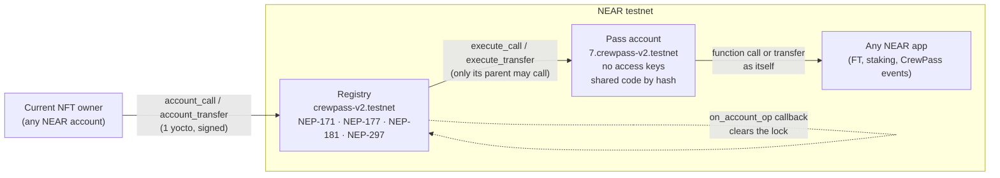
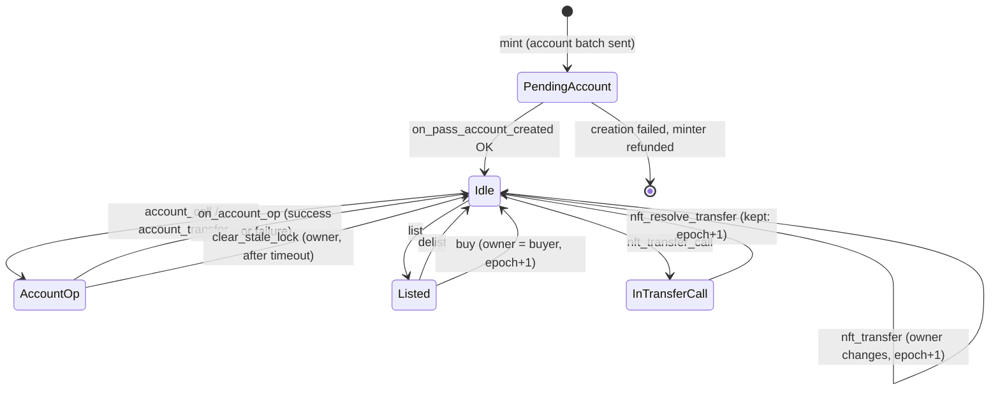

# ADR-001: How a CrewPass V2 pass owns a real NEAR account

| | |
|---|---|
| **Status** | Accepted (2026-11-12) |
| **Decides** | How each membership NFT is bound to its own NEAR account, and how control of that account follows the NFT |
| **Applies to** | CrewPass V2 (`contract-v2/`, `pass-account/`). V1 (`crewpass.testnet`) is unchanged and stays live as evidence. |

## Context

In V1 each pass had a "vault": a number inside the CrewPass contract. That is internal accounting, not
an account. V2 must give every pass a **real NEAR account** that:

1. is permanently and uniquely tied to one token;
2. holds real NEAR (and can hold tokens) on its own, outside the NFT contract's books;
3. is controlled only by the current NFT owner;
4. leaves the previous owner with **no** usable key or other route to operate it;
5. can call other NEAR applications;
6. changes controller safely when the NFT is sold or transferred, including when calls are asynchronous;
7. has a defined answer for recovery and failure cases.

The hackathon runs on **NEAR testnet**. The team cannot fund mainnet.

## What we checked (and how)

| Thing | Finding | How we know |
|---|---|---|
| **House of Stake TLA contracts** | Names are NEP-171 tokens that are also real keyless accounts running a shared `hos-wallet` contract, "published once as a global contract"; a registry plus an extension contract handle transfers; owners control the name from an existing account. **Deployed on mainnet only** (`registry.hos`). | `houseofstake/tla-contracts` README and source; mainnet RPC calls; testnet RPC: account `hos` does not exist |
| Running HoS ourselves on testnet | Would mean deploying an unaudited fork of a nine-contract system. Building its integration tests crashed WSL twice on the development machine (2026-11-06). | `scripts/verify-hos.sh` (did not complete) |
| **NEP-641** | Titled "Offchain Authorizations for Smart Contracts" (`w_resolve_auth`). It is an authorisation format, **not** an NFT-to-account binding standard. HoS leased accounts implement it for signing. | NEP-641 text |
| **NEP-171 / NEP-177** | Core NFT standard; events v1.2.0 include `nft_metadata_update { token_ids }`. | NEP-171 text |
| **Access keys** | A full-access key can do anything, including deleting the account or adding keys. A key given to a holder can be copied and kept after a sale. Function-call keys can be limited to one contract and method list. | docs.near.org access keys |
| **Global contracts** | Code is published once; an account attaches it with `UseGlobalContract` by **code hash** (immutable) or by account ID (follows updates). An account using it stores only a reference. near-sdk 5.30.1 has `Promise::use_global_contract(hash)`. | docs.near.org global contracts; docs.rs near-sdk 5.30.1 `Promise`; sandbox nearcore 2.14.0 |
| **Async receipts** | A cross-contract call runs in later receipts. Anything checked in receipt 1 can change before receipt 2 runs. Only actions inside one receipt are atomic. | NEAR runtime model |

## Options considered

### A. Use House of Stake TLAs directly: rejected (not available)

Strongest real-world precedent, but it exists only on mainnet. We may not claim integration we cannot
run. We follow its *pattern* (keyless account + shared global wallet code + registry as the authority)
in our own contracts.

### A′. Keyless accounts with on-chain controller rotation (store a controller inside each account): rejected

The account stores "controller = alice"; a sale sends a second receipt to set "controller = carol".
Between the sale receipt and the rotation receipt, Alice is still the controller. If the rotation
receipt fails, ownership and control disagree. Making this safe needs a two-phase state machine with
locks, retries and a stuck-state escape. It is all extra failure surface for no gain.

### A″. Give the holder a key to the account: rejected

A full-access key, or even a function-call key, can be copied. After a sale the seller would still
hold it until a rotation receipt removed it, and a full-access key can add more keys or delete the
account. The brief forbids this.

### B. Registry-controlled keyless accounts (chosen)

### C. Deterministic / universal account IDs (`state_init`, feature-gated in near-sdk): not chosen

These derive the account ID from its code and initial state. They are newer, behind SDK feature flags,
and give unreadable IDs. Named sub-accounts (`7.crewpass-v2.testnet`) give the same uniqueness, are
readable in any explorer, and can only be created by the parent.

### V1 internal ledger: superseded

Kept live as evidence. Not a real account.

## Decision

1. **One account per pass, created by the registry.** Minting pass *N* creates the sub-account
   `N.<registry>` in one batch receipt: `CreateAccount` + `UseGlobalContract(<pass-account code hash>)`
   + `Transfer(seed)`. Only a parent can create its sub-accounts and token IDs are never reused, so the
   link token *N* ⇄ account `N.<registry>` is unique and permanent.
2. **The account has no access keys.** Nobody holds a key that could be copied, kept or stolen. It can
   act only through its code.
3. **The account obeys exactly one caller: its parent.** The pass-account code derives its parent
   from its own account ID (`7.crewpass-v2.testnet` → `crewpass-v2.testnet`). There is no stored
   controller to rotate.
4. **The registry obeys only the current NFT owner,** read from `owner_by_id` in the same receipt
   that accepts the request. Control therefore *is* NFT ownership: when ownership changes in the
   registry, control changes in that same receipt. **No rotation step exists, so no rotation can fail.**
5. **Asynchronous operations lock the pass.** When the owner starts an account operation, the registry
   records an operation lock before sending the cross-contract call. While locked, the pass cannot be
   transferred, sold, listed, sent through `nft_transfer_call` or start a second operation. The lock is
   cleared by the `on_account_op` callback, which runs whether the call succeeded or failed. This is
   the transfer state machine below. It is not "one atomic transaction". It is a lock held across
   several receipts.
6. **The pass-account code is attached by hash,** so it is immutable. A registry redeploy cannot change
   the code in existing accounts. It can change what the registry asks the accounts to do, so the
   registry is the trust root (see Consequences).
7. **Passes cannot be owned by pass accounts.** Transfers, sales and mints to any sub-account of the
   registry are refused. Otherwise a pass could end up controlled by its own account (or a cycle of
   accounts) and be frozen forever.

### Transfer state machine (per token)

| From | Allowed | Refused |
|---|---|---|
| Idle | everything the owner may do | — |
| AccountOp | reading; anyone may top up the account or claim rewards into it | transfer, sale, list, transfer_call, another account op |
| Listed | `buy`, `delist` | transfer, transfer_call, account ops |
| InTransferCall | resolve only | everything else, including account ops by the temporary receiver |

Every ownership change increases the pass's **`owner_epoch`**. The web server uses it to key private
companion memory, so a former owner who buys the same pass back starts an empty conversation.

### Money flows

| Flow | Destination | When |
|---|---|---|
| Account seed (part of mint price) | Pass account | Same batch receipt as account creation |
| Referral commission | **Referrer pass's account** (real NEAR) | Right after the new pass's account is created |
| Ticket revenue, member share | Programme reward pool → per-pass accrual (an index, O(1) per sale) | Ticket purchase receipt |
| Creator-funded rewards | Same pool | `fund_rewards` receipt |
| Accrued rewards | **Pass account** (real NEAR) | `claim_rewards`, callable by anyone, always pays the pass's own account |
| Creator share | Programme treasury inside the registry | Mint / ticket receipt; creator withdraws with `withdraw_treasury` |

Rewards that have accrued but not been claimed belong to the token, so they follow it on sale.

## Consequences

**Good**
- No key exists that a seller could keep. Previous owners have no route to the account: the account
  only obeys the registry, and the registry only obeys the current owner.
- Control changes in the same receipt as ownership; there is no rotation window and no failed rotation.
- The account is a normal NEAR account: it holds NEAR, can register with FT contracts, hold FTs and
  NFTs, stake, buy CrewPass tickets, and its balance is visible in any explorer.

**Costs and limits (recorded in THREAT_MODEL.md)**
- **The registry is the trust root.** Whoever controls `crewpass-v2.testnet` (its full-access key or a
  redeploy) controls every pass account. During the hackathon the key is kept for fixes; removing it
  makes the system immutable and is listed as a pre-mainnet step, not done yet.
- **Lock liveness.** If an `on_account_op` callback ever failed, the pass would stay locked. The
  callback is small with a fixed gas budget; as a backstop the **current owner** may clear a lock older
  than `LOCK_TIMEOUT_BLOCKS`.
- **Multi-hop calls.** The lock covers the call chain the account returns. Later receipts that an
  external contract starts by itself (for example a refund) can land after the lock clears; they only
  ever pay *into* the account, which belongs to the new owner by then.
- **Gas.** Each account operation is registry → account → target → callback, so the target gets at
  most `MAX_ACCOUNT_CALL_GAS`.
- **Sybil referrals** remain possible with several accounts.

## Recovery and exceptional cases

| Case | Behaviour |
|---|---|
| Account creation fails at mint | No NFT is minted. The minter gets `price − seed` back at once, and `seed` is recorded as owed and claimable once NEAR's refund lands. Event `pass_mint_failed`. |
| Owner loses their wallet key | Same as any NFT: the pass (and so the account) is lost. Owners can hold passes in a multisig, Ledger or DAO account, since the controller is any NEAR account. No CrewPass admin can recover it, by design. |
| Callback never clears a lock | Current owner calls `clear_stale_lock` after the timeout. |
| Registry key compromised | Total compromise of pass accounts. Mitigation: remove the key after the final deploy (planned). |
| Pass-account code bug | Code is immutable by hash; a fix means a new registry. Mitigated by keeping that code tiny (two forwarding methods). |
